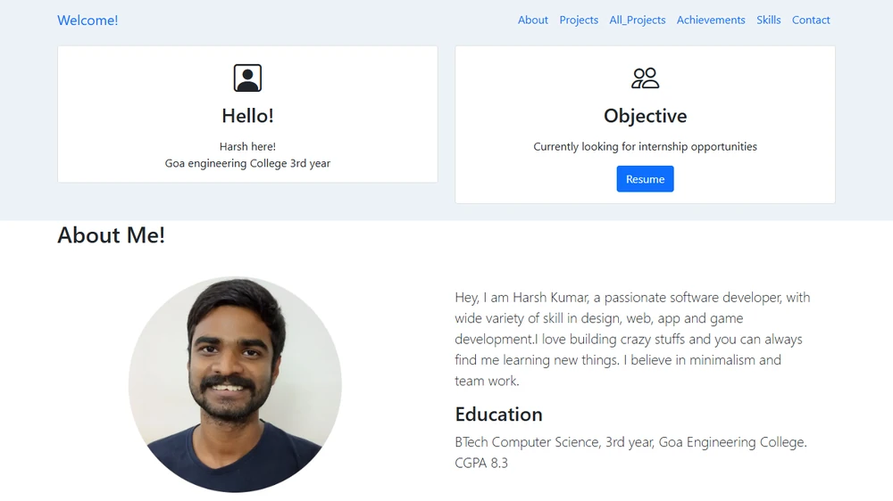
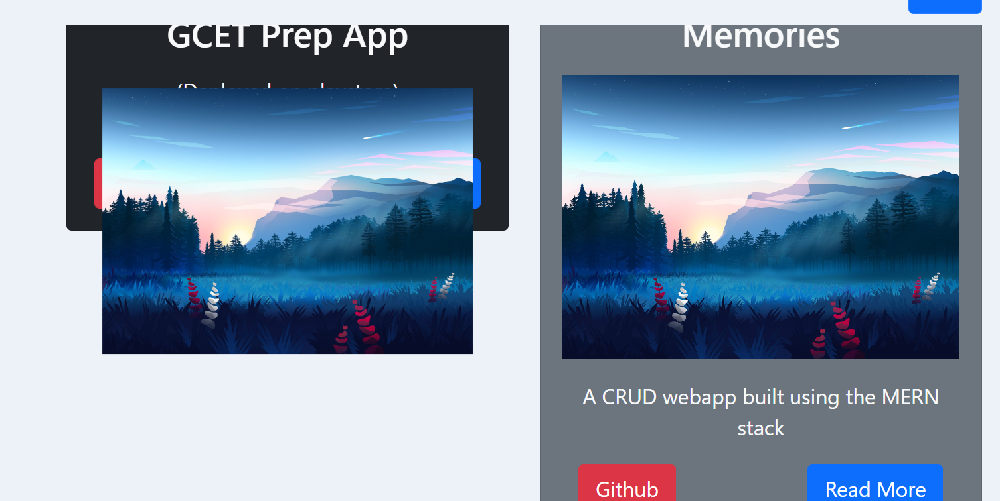

# [ARCHIVED] Harsh Kumar - Personal Portfolio (v1)

> ⚠️ **Status: Deprecated & Archived**  
> This was my personal portfolio built during my 3rd year of BTech at Goa Engineering College. It is now preserved for archival purposes.
>
> 🚀 **Visit my new, interactive portfolio:** **[https://hk2257853.github.io](https://hk2257853.github.io)**

---

## 📸 Visual Archive

---

## 🛠️ Original Tech Stack

- **HTML5 & CSS3**
- **JavaScript (Vanilla)**
- **Bootstrap 5**
- **Hosting (Historic):** Netlify (`harshk-portfolio.netlify.app`)

---

## 📜 About this Version

Built around 2023, this site showcased my early college projects (Android apps, hackathon projects, and freelance web work) before transitioning to my current focus on distributed systems, backend engineering, and AI architectures.

---

## 💭 The Pre-AI Era ("Those were the days...")

90% of this site was crafted before the generative AI era - back when fixing layouts meant hours in browser DevTools, trial-and-error with custom CSS, and asking the developer community for help.

Case in point: debugging the classic Bootstrap card image overflow issue ([Stack Overflow thread](https://stackoverflow.com/questions/73176483/image-falling-out-of-bootstrap-card-after-adding-custom-css)):

